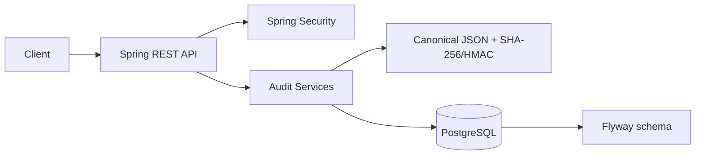

# Architecture

Create requests lock the single chain-state row, construct the next sequence and previous hash, calculate the event hash and commit event plus state in one transaction. Verification scans by sequence and stops at the first gap, previous-link mismatch or recalculated-hash mismatch.

## Trust boundaries
The API and HMAC key are trusted. PostgreSQL content is treated as potentially modifiable. Because the key and application may share an administrative boundary in this prototype, production should use managed key storage, signed external checkpoints and immutable archival storage.
